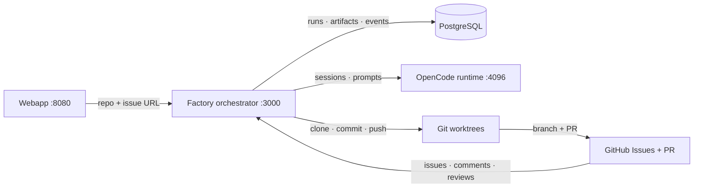

# Software Factory

AI agents turn **GitHub Issues** into Pull Requests on
[OpenCode](https://opencode.ai), while a deterministic orchestrator owns the
workflow, state, and delivery.

The "Factory Manager" is the orchestrator, not an LLM. Agents produce artifacts
and recommendations; they do not decide state or publish on their own.



## What it does

- Starts a run from a webapp with **project + issue URL**.
- **Projects** group issues and runs by repository; each project belongs to one
  user and a user can have many projects.
- Webapp sign-in with **email/password or OAuth2** (Google, GitHub, Apple,
  Microsoft Entra ID, GitLab) via stable NextAuth v4.
- Runs, artifacts and events are isolated per user; each account sees only its
  own executions.
- GitHub PR activity arrives through **signed webhooks**, so the factory does
  not poll every project and user. Polling remains an opt-in fallback.
- Planner → Builder → QA → deterministic tests → Reviewer.
- Isolated git worktree and `factory/<ticket>-<run>` branch per run.
- Same-PR rework on `CHANGES_REQUESTED`; PR comments are triaged before any
  rework.
- Opt-in auto-merge after a real human `APPROVED` review.
- Postgres-backed state, artifacts, events, and a small API.

## Quick start

```bash
cp .env.example .env
$EDITOR .env

docker compose up --build -d
docker compose ps
```

`FACTORY_API_TOKEN`, `WEB_AUTH_SECRET` and `GITHUB_APP_WEBHOOK_SECRET` are
required, plus the GitHub App credentials (`GITHUB_APP_ID`,
`GITHUB_APP_PRIVATE_KEY` and `GITHUB_APP_SLUG`). In production the webapp lives
at <https://web.factory.warias.app> and is the only public entry point. The
factory API, OpenCode runtime and PostgreSQL stay inside the cluster.

Webapp: <https://web.factory.warias.app>. Create the first account at
`/register` with email/password or any OAuth2 provider configured in `.env`;
then create a project with a name and a GitHub repository. If the GitHub App is
not installed on that repository yet, the webapp offers the installation flow.
Issues are launched inside a project and must belong to its repository.

Health:

```bash
# Local Docker Compose (FACTORY_HOST_PORT from .env)
curl -H "Authorization: Bearer $FACTORY_API_TOKEN" \
  "http://127.0.0.1:${FACTORY_HOST_PORT:-3000}/health"

# Kubernetes: the factory is internal, so port-forward it
kubectl -n software-factory port-forward svc/factory 3000:3000
curl -H "Authorization: Bearer $FACTORY_API_TOKEN" http://127.0.0.1:3000/health
```

The factory API requires the bearer token on every route and is not exposed by
the production Ingress.

PR activity is event-driven through a **GitHub App**. Configure the App's
webhook once (not per repository):

```text
Webhook URL: https://web.factory.warias.app/api/github/webhook
Setup URL:   https://web.factory.warias.app/api/github/install/callback
Secret:      GITHUB_APP_WEBHOOK_SECRET
```

Subscribe to **Pull requests**, **Pull request reviews**, **Pull request review
comments**, **Issue comments**, **Check suites**, **Check runs** and **Commit
statuses**. The App sends events for every repository where it is installed; the
webapp verifies `X-Hub-Signature-256` and forwards them to the internal factory
API. Users only install the App once per repository or organization. When the
webapp is LAN-only, expose the webhook through a host-level Tailscale Funnel
(see [Kubernetes / k3s](docs/kubernetes.md#tailscale-funnel-no-public-ip)).
Set `FACTORY_PR_POLLING=true` only as a temporary fallback until webhooks are
verified.

Your local OpenCode is never touched. The factory runs its own OpenCode
container on an internal port, with its own config and data volume.

## Production on k3s

The `charts/software-factory` Helm chart deploys PostgreSQL, the isolated
OpenCode runtime, the factory orchestrator and the Next.js webapp into the
`software-factory` namespace. Only the webapp is exposed, through an HTTPS
Ingress issued by cert-manager/Let's Encrypt; the GitHub webhook also enters
through the webapp. A LAN-only cluster can expose just the webhook path with a
host-level Tailscale Funnel instead of a public Ingress. Secrets are sealed with
Sealed Secrets and stored as Kubernetes Secrets in the cluster; no plaintext
secret is mounted or baked into
an image. The sealed secret is generated locally from `.env` on every deploy
and is gitignored.

```bash
./scripts/install-sealed-secrets.sh   # once per cluster
./scripts/deploy-remote-k3s.sh <REMOTE_USER> <REMOTE_HOST>
# add --funnel to also enable the host-level Tailscale Funnel for webhooks
# add --prune to remove old software-factory images after a successful rollout
```

See [Kubernetes / k3s](docs/kubernetes.md) for prerequisites, DNS, the full
secret list and troubleshooting.

## Documentation

| Guide | Contents |
| --- | --- |
| [Documentation index](docs/README.md) | all guides in one place |
| [Getting started](docs/getting-started/README.md) | requirements, isolation, first run, GitHub App, toolchain detection |
| [Configuration](docs/configuration/README.md) | models, auto-merge, rework, comment triage, env reference |
| [Local testing](docs/local-testing/README.md) | tests, Compose, end-to-end runs, host development, troubleshooting |
| [Operations](docs/operations/README.md) | lifecycle, states, artifacts, API, agents, project map |
| [Security](docs/security/README.md) | secrets, trust boundaries, exposure, limits |
| [Architecture](docs/architecture.md) | components, state machine, worktrees, failure handling |
| [Phases](docs/phases.md) | MVP → parallel → autonomous → multi-asset factory |

## Status

Phase 1 is implemented and runnable locally with Docker Compose. It supports one
run at a time; parallelism, budgets, dashboards, and advanced recovery are
future phases.

## Safety

- `.env` is gitignored, should stay at `600`, and must never be committed.
- The factory authenticates to GitHub as a **GitHub App**. Users install the App
  only on the repositories they want to use; no PAT or per-repo webhook is
  shared. Keep the App private key and webhook secret in `.env` or a mounted
  secret file.
- Run the factory only against trusted repositories: agents execute build and
  test commands in the OpenCode container.

See [Security](docs/security/README.md) before exposing the webapp or API.

## License

[Apache-2.0](LICENSE)
