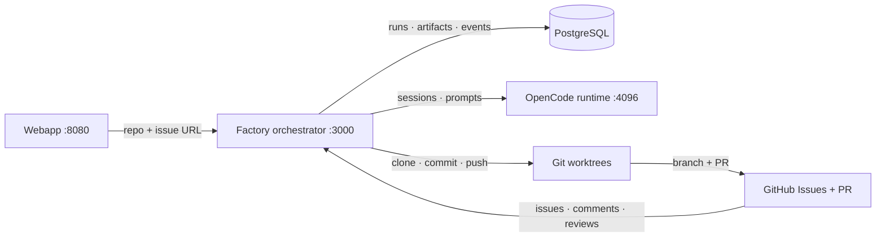

# Software Factory

AI agents turn **GitHub Issues** into Pull Requests on
[OpenCode](https://opencode.ai), while a deterministic orchestrator owns the
workflow, state, and delivery.

The "Factory Manager" is the orchestrator, not an LLM. Agents produce artifacts
and recommendations; they do not decide state or publish on their own.



## What it does

- Starts a run from a webapp with **repo + issue URL**.
- Webapp sign-in with **email/password or OAuth2** (Google, GitHub, Apple,
  Microsoft Entra ID, GitLab) via stable NextAuth v4.
- Runs, artifacts and events are isolated per user; each account sees only its
  own executions.
- Planner → Builder → QA → deterministic tests → Reviewer.
- Isolated git worktree and `factory/<ticket>-<run>` branch per run.
- Same-PR rework on `CHANGES_REQUESTED`; PR comments are triaged before any
  rework.
- Opt-in auto-merge after a real human `APPROVED` review.
- Postgres-backed state, artifacts, events, and a small API.

## Quick start

```bash
cp .env.example .env
$EDITOR .env

docker compose up --build -d
docker compose ps
```

`FACTORY_API_TOKEN` and `WEB_AUTH_SECRET` are required. Generate each one
with `openssl rand -hex 32`.

Webapp: <http://localhost:8080>. Create the first account at `/register` with
email/password or any OAuth2 provider configured in `.env`; from then on the
webapp and its API proxy require a signed-in session.

Health:
`curl -H "Authorization: Bearer $FACTORY_API_TOKEN" http://127.0.0.1:13000/health`
(or your `FACTORY_HOST_PORT`). The factory API requires the bearer token on
every route.

Your local OpenCode is never touched. The factory runs its own OpenCode
container on an internal port, with its own config and data volume.

## Documentation

| Guide | Contents |
| --- | --- |
| [Documentation index](docs/README.md) | all guides in one place |
| [Getting started](docs/getting-started/README.md) | requirements, isolation, first run, GitHub token, toolchain detection |
| [Configuration](docs/configuration/README.md) | models, auto-merge, rework, comment triage, env reference |
| [Local testing](docs/local-testing/README.md) | tests, Compose, end-to-end runs, host development, troubleshooting |
| [Operations](docs/operations/README.md) | lifecycle, states, artifacts, API, agents, project map |
| [Security](docs/security/README.md) | secrets, trust boundaries, exposure, limits |
| [Architecture](docs/architecture.md) | components, state machine, worktrees, failure handling |
| [Phases](docs/phases.md) | MVP → parallel → autonomous → multi-asset factory |

## Status

Phase 1 is implemented and runnable locally with Docker Compose. It supports one
run at a time; parallelism, budgets, dashboards, and advanced recovery are
future phases.

## Safety

- `.env` is gitignored, should stay at `600`, and must never be committed.
- Use a GitHub token restricted to the target repos. Fine-grained PATs cannot
  access private repos owned by another personal account, even as a collaborator;
  use a classic `repo` token in that case.
- Run the factory only against trusted repositories: agents execute build and
  test commands in the OpenCode container.

See [Security](docs/security/README.md) before exposing the webapp or API.

## License

[Apache-2.0](LICENSE)
