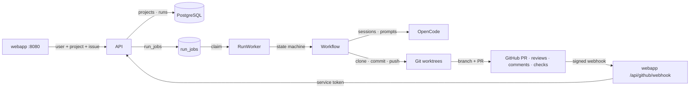
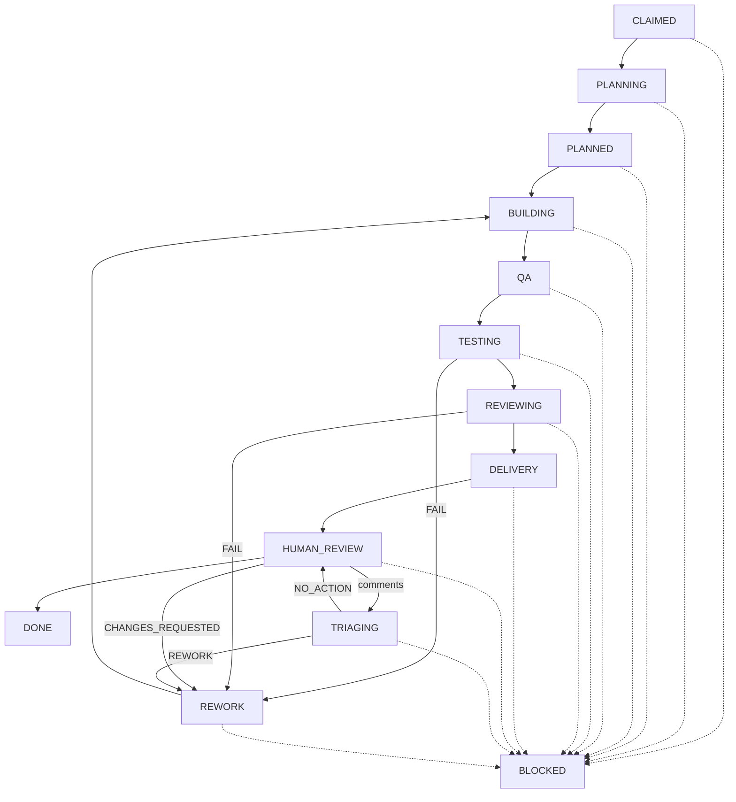

# Architecture

## Guiding principle

OpenCode is the **agent runtime**, not the global orchestrator. The factory
separates **event ingestion** (GitHub webhooks, optional `TriggerWatcher`) from
**job execution** (`RunWorker` + `Workflow`). Ingestion only decides that a run
needs work and enqueues a job; the worker owns state transitions and invokes
agents.

A user creates projects (name + repository) and launches issues inside a
project. A run stores its `owner_user_id` and `project_id`; every user-facing
read is scoped to the owner. PR activity is pushed by GitHub instead of polled
across all projects; `FACTORY_PR_POLLING=true` enables the old polling fallback.
Worktrees are prepared without running any command: the Planner runs first, the
Builder performs setup/build/tests, and a verifier agent runs the test gate.

## Components

| Component | Responsibility |
| --- | --- |
| `src/index.ts` | bootstrap, configuration validation, shutdown |
| `src/api.ts` | HTTP API: projects, runs, and internal GitHub event intake |
| `web/` | Next.js webapp: login, projects, runs, public webhook ingress |
| `web/app/api/github/webhook/route.ts` | verifies GitHub HMAC and forwards events |
| `src/backlog/github-events.ts` | maps webhook payloads to repository/PR/branch targets |
| `src/trigger-watcher.ts` | optional polling fallback; enqueues `run_jobs` only |
| `src/run-worker.ts` | claims jobs and invokes the workflow |
| `src/workflow.ts` | state machine, artifacts, agent orchestration, git plumbing |
| `src/backlog/github.ts` | GitHub Issues connector (`BacklogPort`) |
| `src/runtime/opencode.ts` | OpenCode Server client (`AgentRuntimePort`) |
| `src/scm/git.ts` | per-repo clone, worktrees, commits, diff, push |
| `src/scm/github.ts` | PR creation, reviews, merge |
| `src/github-app.ts` | GitHub App JWT and cached installation tokens |
| `src/store/postgres.ts` | persistence (`projects`, `runs`, `run_jobs`) |
| `src/domain/state.ts` | state machine and transition validation |
| `src/domain/verification.ts` | verifier JSON parser |
| `src/domain/ticket.ts` | ticket normalization and acceptance criteria |
| `src/squad/prompts.ts` | role prompts and PR body |

The ports (`src/ports.ts`) make it possible to test the workflow with in-memory
doubles and replace GitHub Issues, OpenCode, or PostgreSQL without touching the
logic.

## Projects and event ingestion

- `projects` belongs to one `users` row and stores `name`, `repo`, `repo_url`.
  A user may have many projects; `(owner_user_id, repo)` is unique.
- `runs` stores `owner_user_id` and `project_id`. `POST /api/runs` accepts a
  `projectId` and rejects an issue whose repository differs from the project.
- The public entry point for GitHub is `POST /api/github/webhook` in the webapp.
  It verifies `X-Hub-Signature-256` with `GITHUB_APP_WEBHOOK_SECRET` and forwards
  the event to the token-protected `POST /api/github/events` in the factory.
- The App webhook is configured once at App level, not per repository. The App
  is installed on selected repos/orgs; installation tokens are resolved per
  repository and used for Issues, PRs, reviews and git.
- The factory maps `repository.full_name` to projects and human-review runs,
  then enqueues one `pr_sync` job per matching run. `X-GitHub-Delivery` is part
  of the dedup key, so GitHub retries are idempotent.
- Supported events: `pull_request`, `pull_request_review`,
  `pull_request_review_comment`, `issue_comment`, `check_suite`, `check_run` and
  `status`. Branch-based `status` events match the run branch; the rest match the
  PR number.
- `FACTORY_PR_POLLING=false` by default. `true` restores the old global scan of
  `HUMAN_REVIEW` runs for local work without a public webhook URL.

## Workflow ownership

Agents **do not** change state. The workflow:

1. validates that the transition is legal (`assertTransition`);
2. persists the new state and an event;
3. invokes the corresponding agent or gate.

An agent may recommend that a task is finished, but it cannot declare it
finished. The Reviewer only provides a verdict; the workflow decides whether
that means `DELIVERY`, `REWORK`, or `BLOCKED`. The TriggerWatcher can only
enqueue jobs, never transition a run.

## State machine

Invariants:

- You cannot skip from `PLANNING` to `BUILDING` or from `CLAIMED` to `DELIVERY`.
- `REWORK` can only return to `BUILDING`.
- `HUMAN_REVIEW`, `DONE`, and `BLOCKED` are terminal for automation;
  `HUMAN_REVIEW` can be reactivated by a `CHANGES_REQUESTED` review (straight to
  `REWORK`) or by comments that go through `TRIAGING`.
- `BLOCKED` requires human intervention; starting a new run for the same open
  issue creates a fresh run (the unique index only covers runs with
  `finished_at IS NULL`).

## Isolation with git worktrees

Each run has:

- worktree: `/data/worktrees/<ticket>-<run-id>/`
- branch: `factory/<ticket>-<run-id>`

The base repository is cloned once into `/data/repos/<repo>/`. The worktree is
created from `origin/<base>` and reused if the process restarts. Agents never
share a directory.

The workflow is the only actor that runs `git add`, `commit`, `push`, and
creates the PR. Agent prompts explicitly forbid rewriting history. The Builder
works on the working tree and the workflow commits when it finishes.

## Artifacts

`artifacts` stores text and metadata per step. They are the contract between
agents:

- the plan feeds the Builder, QA, and Reviewer;
- the build report (including setup/test results) feeds QA;
- the verifier report and QA report feed the Reviewer;
- the Reviewer verdict decides the transition;
- the PR is built from all of them.

Metadata enables deterministic decisions: `tests.passed` and `review.verdict`
are stored as JSONB, not re-parsed from free text.

## Failure handling

- **Agent error or timeout**: the session is interrupted and the run moves to
  `BLOCKED` with the reason in PostgreSQL and on the issue.
- **Red tests**: feedback to the Builder and another cycle, up to
  `FACTORY_MAX_REWORK`.
- **Review FAIL**: same mechanism, with the findings as feedback.
- **Builder with no changes**: blocked; avoids empty PRs and silent loops.
- **Delivery failure**: push/PR fails → `BLOCKED`, never a fake `HUMAN_REVIEW`.
- **GitHub failure while updating the issue after creating the PR**: the warning
  is recorded and the run is marked `HUMAN_REVIEW`; the work has already been
  delivered.

`claimNext` selects the oldest active run. In Phase 1 there is one worker (one
replica). The `working` flag prevents overlap inside the process, and the
PostgreSQL unique index prevents two active runs for the same owner and ticket.
Concurrent processing of the same run (leases) is left for Phase 2.

## Security

- The OpenCode server uses basic authentication (`OPENCODE_SERVER_PASSWORD`) and
  is not published outside the Compose network.
- Runs are owned by the webapp user that created them. The API scopes
  `GET /api/runs` and `GET /api/runs/:id` to the `X-Factory-User-Id` supplied by
  the authenticated webapp; artifacts and events are only reachable through an
  owned run.
- Agents have role-based permissions in their Markdown definition. The
  Planner/Reviewer (read-only) and Builder (write) separation is intentional.
- OpenCode permission requests are answered automatically only for sessions
  created by the factory; they are written to logs. This can be disabled with
  `FACTORY_AUTO_APPROVE_PERMISSIONS=false`.
- GitHub App installation tokens are resolved per repository, kept in memory
  only, and are not written to `.git/config`.
- The container only mounts the data volume and the agents; not the host home.
- The target repo is resolved from the project; the App installation decides
  which repositories can be cloned and pushed.
- Build and test commands are executed by agents inside the OpenCode container;
  treat the target repo as trusted code.

### OpenCode runtime isolation

The factory runtime is deliberately separate from the developer's OpenCode:

- `XDG_CONFIG_HOME=/config`, `XDG_DATA_HOME=/data/opencode/data`,
  `XDG_CACHE_HOME=/data/opencode/cache`, `XDG_STATE_HOME=/data/opencode/state`,
  and `HOME=/data/opencode/home`, all inside the container/volume.
- `/config/opencode` only contains the factory's `opencode.json` and the agents
  mounted read-only.
- `~/.config/opencode`, `~/.local/share/opencode`, and `~/.opencode` are not
  mounted.
- Port 4096 is not published; for host development, `compose.dev.yaml` publishes
  `14096` (OpenCode) and `15432` (PostgreSQL) on `127.0.0.1`.
- `FACTORY_OPENCODE_URL` is required: there is no silent fallback to
  `127.0.0.1:4096`, which could be the developer's local runtime.

Verification: `docker compose exec opencode opencode debug paths` must show every
path under `/config` or `/data`.

## Evolution

Phase 2 replaces the single worker with a queue and adds parallel builders. The
ports already separate backlog, runtime, workspace, and delivery, so the change
is concentrated in the orchestrator and the data model (child tasks,
dependencies, leases). See [`phases.md`](phases.md).
