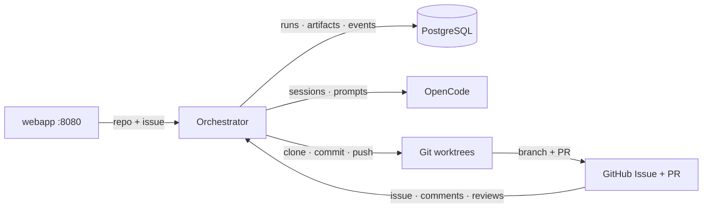
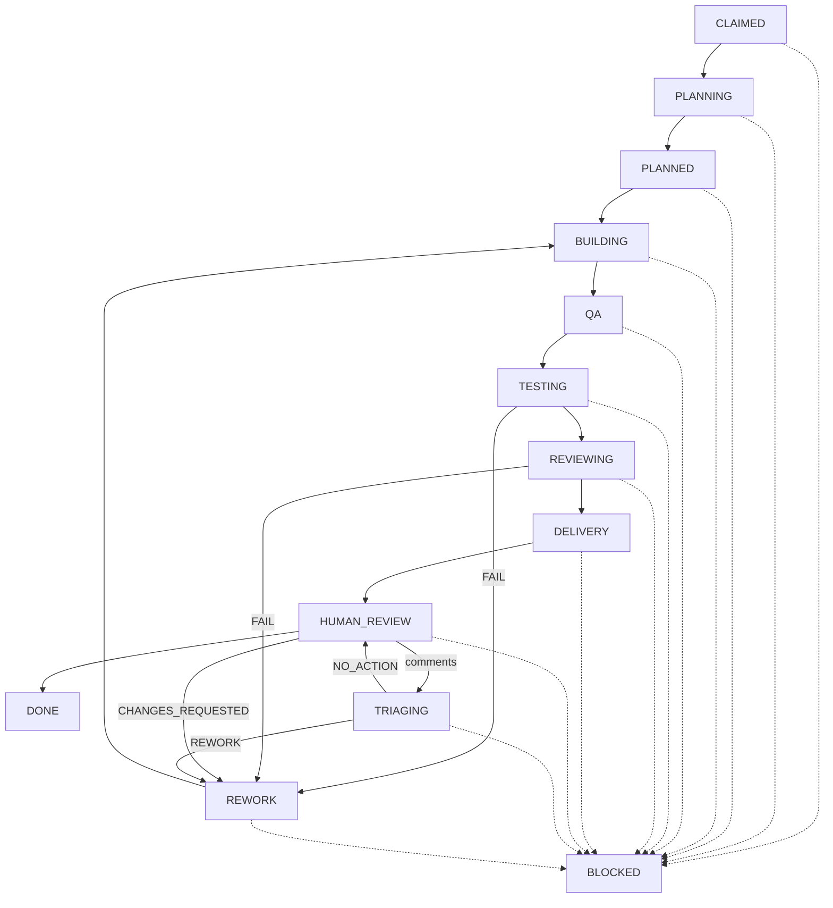

# Architecture

## Guiding principle

OpenCode is the **agent runtime**, not the global orchestrator. The orchestrator
is a dedicated service that decides what runs, when, and by whom. This makes it
possible to replace the runtime without rewriting the workflow.

The repo and issue arrive at runtime from the webapp or `POST /api/runs`.

## Components

| Component | Responsibility |
| --- | --- |
| `src/index.ts` | bootstrap, configuration validation, shutdown |
| `src/api.ts` | HTTP API, including `POST /api/runs` (repo + issue URL) |
| `web/` | webapp to start runs and inspect their state |
| `src/orchestrator.ts` | single worker, delivered-run sync (`Done`, reviews) |
| `src/workflow.ts` | ticket pipeline and state transitions |
| `src/backlog/github.ts` | GitHub Issues connector (`BacklogPort`) |
| `src/runtime/opencode.ts` | OpenCode Server client (`AgentRuntimePort`) |
| `src/scm/git.ts` | per-repo clone, `.factory.yml`, worktrees, commits, tests, push |
| `src/scm/github.ts` | idempotent Pull Request creation in the run's repo |
| `src/store/postgres.ts` | persistence (`RunStore`) |
| `src/domain/state.ts` | state machine and transition validation |
| `src/domain/ticket.ts` | ticket normalization and acceptance criteria |
| `src/squad/prompts.ts` | role prompts and PR body |

The ports (`src/ports.ts`) make it possible to test the workflow with in-memory
doubles and replace GitHub Issues, OpenCode, or PostgreSQL without touching the
logic.

## Workflow ownership

Agents **do not** change state. The orchestrator:

1. validates that the transition is legal (`assertTransition`);
2. persists the new state and an event;
3. runs the corresponding gate.

An agent may recommend that a task is finished, but it cannot declare it
finished. The Reviewer only provides a verdict; the orchestrator decides whether
that means `DELIVERY`, `REWORK`, or `BLOCKED`.

## State machine

Invariants:

- You cannot skip from `PLANNING` to `BUILDING` or from `CLAIMED` to `DELIVERY`.
- `REWORK` can only return to `BUILDING`.
- `HUMAN_REVIEW`, `DONE`, and `BLOCKED` are terminal for automation;
  `HUMAN_REVIEW` can be reactivated by a `CHANGES_REQUESTED` review (straight to
  `REWORK`) or by comments that go through `TRIAGING`.
- `BLOCKED` requires human intervention; starting a new run for the same open
  issue creates a fresh run (the unique index only covers runs with
  `finished_at IS NULL`).

## Isolation with git worktrees

Each run has:

- worktree: `/data/worktrees/<ticket>-<run-id>/`
- branch: `factory/<ticket>-<run-id>`

The base repository is cloned once into `/data/repos/<repo>/`. The worktree is
created from `origin/<base>` and reused if the process restarts. Agents never
share a directory.

The orchestrator is the only actor that runs `git add`, `commit`, `push`, and
creates the PR. Agent prompts explicitly forbid rewriting history. The Builder
works on the working tree and the orchestrator commits when it finishes.

## Artifacts

`artifacts` stores text and metadata per step. They are the contract between
agents:

- the plan feeds the Builder, QA, and Reviewer;
- the build report feeds QA;
- the test output and QA report feed the Reviewer;
- the Reviewer verdict decides the transition;
- the PR is built from all of them.

Metadata enables deterministic decisions: `tests.passed` and `review.verdict`
are stored as JSONB, not re-parsed from free text.

## Failure handling

- **Agent error or timeout**: the session is interrupted and the run moves to
  `BLOCKED` with the reason in PostgreSQL and on the issue.
- **Red tests**: feedback to the Builder and another cycle, up to
  `FACTORY_MAX_REWORK`.
- **Review FAIL**: same mechanism, with the findings as feedback.
- **Builder with no changes**: blocked; avoids empty PRs and silent loops.
- **Delivery failure**: push/PR fails → `BLOCKED`, never a fake `HUMAN_REVIEW`.
- **GitHub failure while updating the issue after creating the PR**: the warning
  is recorded and the run is marked `HUMAN_REVIEW`; the work has already been
  delivered.

`claimNext` selects the oldest active run. In Phase 1 there is one worker (one
replica). The `working` flag prevents overlap inside the process, and the
PostgreSQL unique index prevents two active runs for the same ticket. Concurrent
processing of the same run (leases) is left for Phase 2.

## Security

- The OpenCode server uses basic authentication (`OPENCODE_SERVER_PASSWORD`) and
  is not published outside the Compose network.
- Agents have role-based permissions in their Markdown definition. The
  Planner/Reviewer (read-only) and Builder (write) separation is intentional.
- OpenCode permission requests are answered automatically only for sessions
  created by the factory; they are written to logs. This can be disabled with
  `FACTORY_AUTO_APPROVE_PERMISSIONS=false`.
- The GitHub token is used in memory for git and the API; it is not written to
  `.git/config`.
- The container only mounts the data volume and the agents; not the host home.
- The target repo is resolved per run from the webapp/API; the GitHub token's
  permissions decide what can be cloned and pushed.
- `.factory.yml` is executed from the target repo: treat it as trusted code and
  do not point the factory at untrusted repos.

### OpenCode runtime isolation

The factory runtime is deliberately separate from the developer's OpenCode:

- `XDG_CONFIG_HOME=/config`, `XDG_DATA_HOME=/data/opencode/data`,
  `XDG_CACHE_HOME=/data/opencode/cache`, `XDG_STATE_HOME=/data/opencode/state`,
  and `HOME=/data/opencode/home`, all inside the container/volume.
- `/config/opencode` only contains the factory's `opencode.json` and the agents
  mounted read-only.
- `~/.config/opencode`, `~/.local/share/opencode`, and `~/.opencode` are not
  mounted.
- Port 4096 is not published; for host development, `compose.dev.yaml` publishes
  `14096` (OpenCode) and `15432` (PostgreSQL) on `127.0.0.1`.
- `FACTORY_OPENCODE_URL` is required: there is no silent fallback to
  `127.0.0.1:4096`, which could be the developer's local runtime.

Verification: `docker compose exec opencode opencode debug paths` must show every
path under `/config` or `/data`.

## Evolution

Phase 2 replaces the single worker with a queue and adds parallel builders. The
ports already separate backlog, runtime, workspace, and delivery, so the change
is concentrated in the orchestrator and the data model (child tasks,
dependencies, leases). See [`phases.md`](phases.md).
