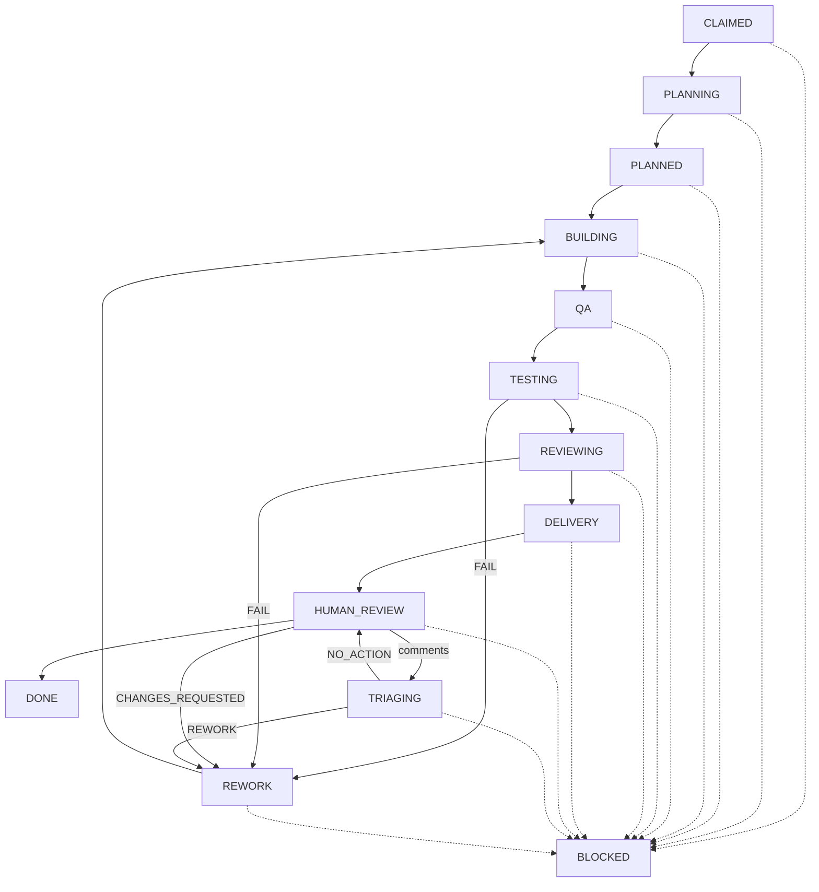

# Operations

## Run lifecycle

1. The webapp or `POST /api/runs` receives repo + issue URL, creates a run
   (`CLAIMED`) and enqueues a `start_issue` job.
2. The factory validates the issue/repo pair, fetches the issue, and applies
   `factory:in-progress` plus a comment.
3. The worker claims the job; it clones the target repo and creates an isolated
   worktree in `factory-data`.
4. **Planner** explores the repo and produces `plan`.
5. **Builder** installs dependencies, implements the ticket, runs setup/build/
   tests, and fixes failures. It leaves changes uncommitted.
6. The workflow commits; agents are forbidden from rewriting history by prompt
   and permissions.
7. **QA** adds/reviews tests (test files only).
8. **Verifier** inspects the worktree, runs the checks the project uses (tests,
   build, lint, or an equivalent) and returns structured JSON.
   On failure the run returns to `BUILDING` with the output as feedback, up to
   `FACTORY_MAX_REWORK`. With no tests, the gate is skipped.
9. **Reviewer** returns `VERDICT: PASS` or `VERDICT: FAIL`. A FAIL consumes a
   rework cycle.
10. `DELIVERY` pushes the branch and creates a PR in the issue's repo with
    `Closes #<issue>`.
11. The issue is labeled `factory:in-review`; the run stays in `HUMAN_REVIEW`.
    When the PR is merged and the issue closed, the run becomes `DONE`.

## State machine



- `HUMAN_REVIEW`, `DONE`, and `BLOCKED` are terminal for automation.
- `HUMAN_REVIEW` can be reactivated by a `CHANGES_REQUESTED` review (to
  `REWORK`) or by comments (through `TRIAGING`).
- `BLOCKED` needs a human. Reopening the issue or removing state labels can lead
  to a new run.

## Artifacts

| Artifact | Producer | Content |
| --- | --- | --- |
| `plan` | Planner | analysis, criteria, tasks, risks |
| `build` | Builder | summary, changes, setup/test commands and results |
| `qa` | QA | test plan, tests added, result |
| `tests` | Verifier | structured verification result (command, exit code, output) |
| `review` | Reviewer | verdict and findings |
| `delivery` | Workflow | PR URL or local branch path |

Agents communicate through artifacts, not only conversation.

## API

If `FACTORY_API_TOKEN` is set, send `Authorization: Bearer <token>` on
`/api/*`.

| Method | Path | Description |
| --- | --- | --- |
| GET | `/health` | PostgreSQL, OpenCode, trigger watcher and worker |
| GET | `/api/status` | trigger watcher and worker statistics |
| GET | `/api/runs` | latest runs (`?limit=`) |
| GET | `/api/runs/:id` | run + artifacts + events |
| POST | `/api/runs` | create a run and enqueue its start job |
| POST | `/api/tick` | force a trigger scan and a worker cycle |

```bash
curl -s -X POST http://127.0.0.1:13000/api/runs \
  -H 'Content-Type: application/json' \
  -d '{
    "repoUrl": "https://github.com/owner/app",
    "issueUrl": "https://github.com/owner/app/issues/123",
    "baseBranch": "main"
  }' | jq
```

Optional per-run fields: `setupCommand`, `testCommand`.

## Agents

Profiles live in `squads/software-development/agents/` and are mounted into the
OpenCode container as global agents. They are never written into the target
repo.

| Agent | Permissions |
| --- | --- |
| `factory-planner` | read-only; no shell/edit |
| `factory-builder` | read/edit/shell; no subagents; performs setup and tests |
| `factory-qa` | shell + test-file editing only |
| `factory-verifier` | read/shell only; runs the test gate |
| `factory-reviewer` | read-only + read-only `git` |
| `factory-feedback-triage` | read-only + `git`; `NO_ACTION`/`REWORK` |

One OpenCode session per step. Profiles persist; sessions and worktrees are
ephemeral.

## Project map

| Path | Content |
| --- | --- |
| `src/index.ts` | startup, validation, shutdown |
| `src/trigger-watcher.ts` | PR activity detection; enqueues jobs only |
| `src/run-worker.ts` | claims jobs and invokes the workflow |
| `src/workflow.ts` | pipeline and state transitions |
| `src/api.ts` | HTTP API |
| `web/` | Next.js webapp |
| `src/domain/` | types, state machine, issue parser, triage/verification parsers |
| `src/backlog/github.ts` | GitHub Issues connector |
| `src/runtime/opencode.ts` | OpenCode HTTP client |
| `src/scm/git.ts` | clone, worktrees, commits, tests, push |
| `src/scm/github.ts` | PR creation, reviews, merge |
| `src/store/` | PostgreSQL and in-memory stores |
| `src/squad/prompts.ts` | role prompts and PR body |
| `tests/` | unit and workflow tests |
| `compose.yaml` | isolated stack |
| `compose.dev.yaml` | host-development ports |

## Development

```bash
npm install
npm test
npm run typecheck
```

To iterate on the orchestrator on the host, see
[Local testing](../local-testing/README.md#7-host-development).

### Adding an agent

1. Create `squads/software-development/agents/factory-<role>.md`.
2. Add `description`, `mode`, `steps`, `permissions`.
3. Add the ID to `src/index.ts` verification.
4. Add prompt/step in `src/workflow.ts` and transitions in
   `src/domain/state.ts`.
5. Add tests in `tests/workflow.test.ts`.

### Adding a backlog connector

Implement `BacklogPort` in `src/ports.ts` and wire it in `src/index.ts`. The
workflow must remain backlog-agnostic. Follow `src/backlog/github.ts`.

## Project skill (local only)

`.opencode/skills/software-factory/SKILL.md` is the local operational skill. It
is loaded in future OpenCode sessions in this repo but `.opencode/` is gitignored
and not published. Update it when architecture, commands, or isolation rules
change.

## Next

- [Security](../security/README.md)
- [Architecture](../architecture.md)
- [Phases](../phases.md)
